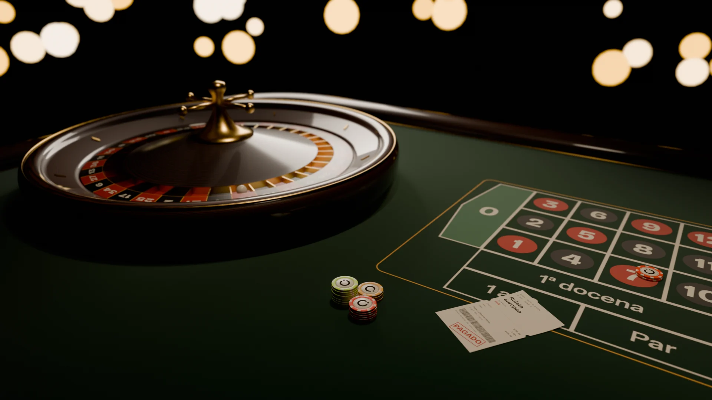
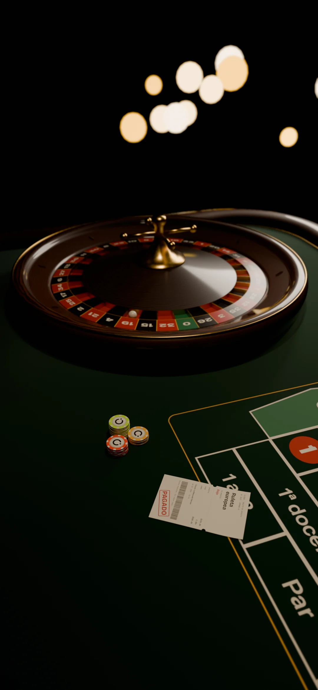
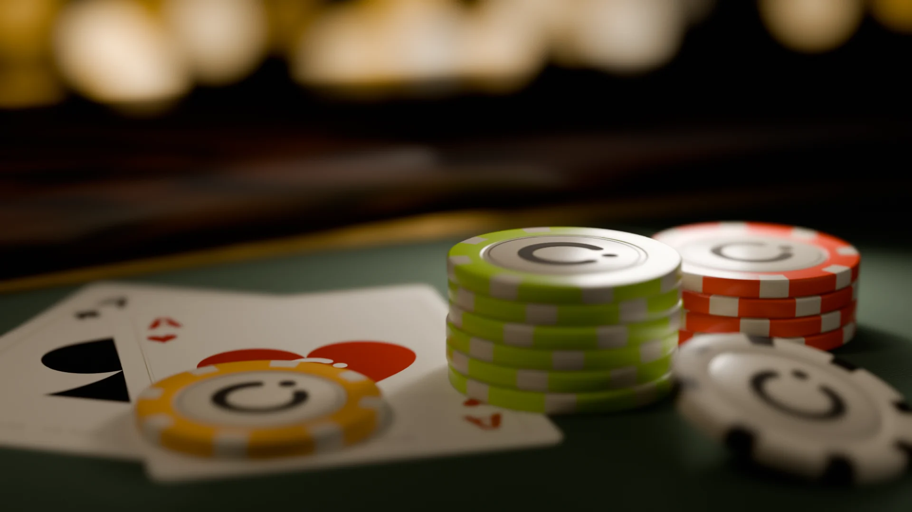
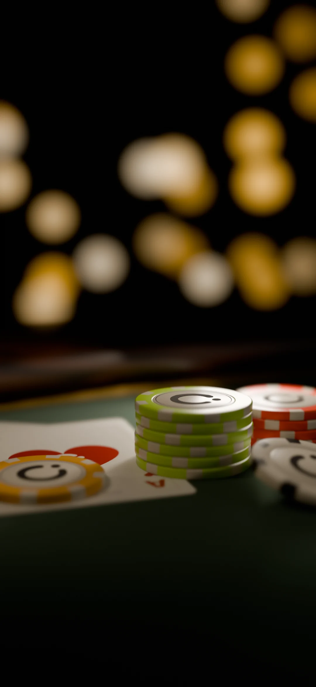
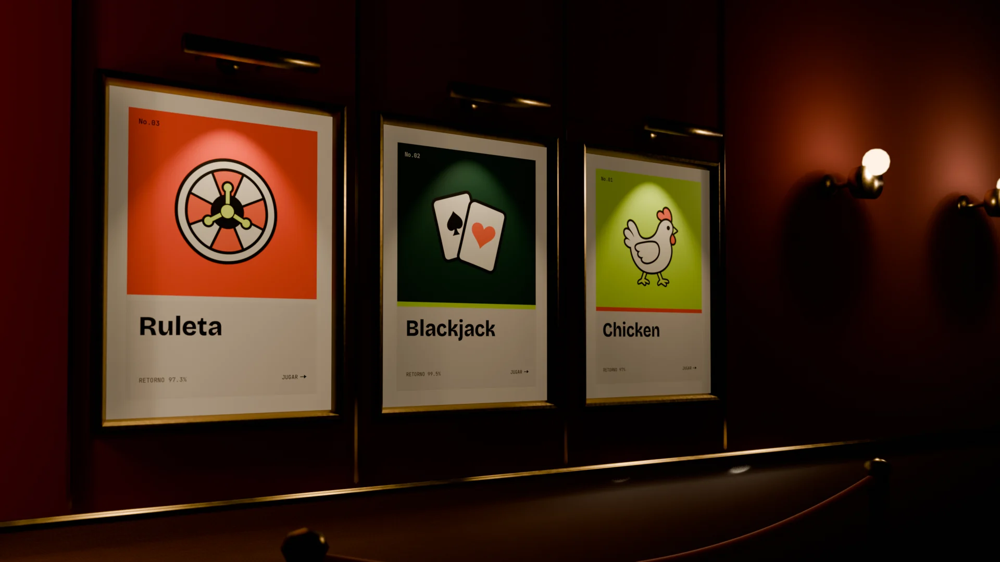
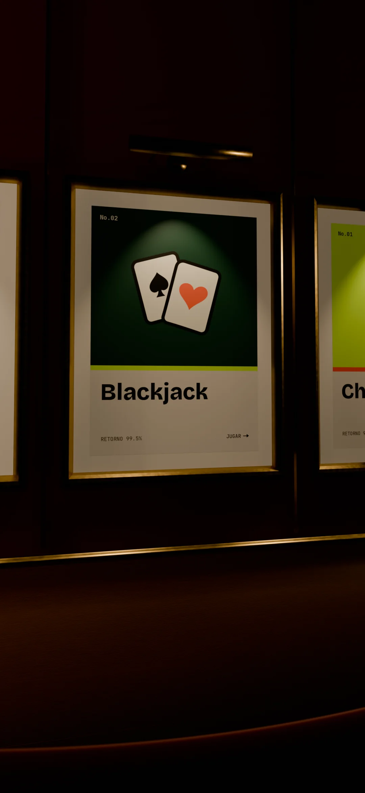

# Bitácora OT-006 — Dirección de arte del casino premium en Blender

**Estado:** En curso. Solo falta un dato del dueño: los cuadros por segundo en su computadora (ver "Preguntas").
**Rama:** `ot/006-direccion-de-arte` · **Agente:** E6 · Arte 3D, ejecutado por E0 con el conector de Blender · **Carpeta:** el taller `Downloads\Clique\_ot006` en la computadora del dueño; los archivos finales viven en esta rama

---

## Sesión 1 — 2026-10-10 (todo el día)

**Objetivo de la sesión:** los tres cuadros de estilo, la ficha lista para la web, la página de prueba y el contrato de arte 3D.

**Hecho:**
- Blender 5.2.2 LTS en la laptop del dueño (RTX 4050, EEVEE), por el conector de Blender de la app de escritorio de Claude. Los agentes de VS Code no tienen ese conector, por eso esta orden la ejecuta el cerebro (nota de la orden).
- Texturas originales generadas con Python a partir de la paleta v2 y de los íconos del legacy (`assets3d/texturas/`):
  - cartas as de picas y as de corazones, con su reverso;
  - boleto "Ruleta europea" con sello PAGADO;
  - pósters de Ruleta, Blackjack y Chicken;
  - paño de apuestas en español ("1ª docena", "Par", "1 a 18", "2 a 1");
  - anillo de 37 números de la rueda.
- **Ficha de Clique:**
  - cuerpo de cerámica con 8 incrustaciones en el canto, centro de papel, filete y "C" en relieve;
  - Ø 0.039 m × 0.0033 m, 6,508 triángulos.
- **Cuadro 1, mesa de ruleta:**
  - mesa de 2.70 × 1.30 m con fieltro, riel de madera lacada, filete de latón y paño impreso;
  - rueda europea completa: tazón, pista, 8 rombos, anillo de números, 37 bolsas con trastes de latón, cono y torre de cuatro brazos;
  - bola en el 19, fichas apostadas, el boleto de Clique y bokeh de lámparas al fondo.
- **Cuadro 2, héroe de ficha y carta:**
  - pilas de fichas lima y bermellón y ficha de oro sobre los ases;
  - ficha de papel desenfocada en primer plano;
  - borde de la mesa con riel y latón, y bokeh cálido.
- **Cuadro 3, lobby:**
  - muro de terciopelo con molduras de latón y lambrín de madera;
  - tres pósters enmarcados en latón, con paspartú y una lámpara de cuadro cada uno;
  - apliques al fondo y poste con cordón de terciopelo en primer plano.
- Renders finales a 1920×1080 y 1080×2340 (EEVEE, 256 muestras), en WebP.
- `ficha.glb` exportada de Blender y optimizada con meshopt (`assets3d/herramientas/optimizar-glb.mjs`). La exportación cruda va en `assets3d/ficha/ficha-exportada.glb` y el script la reproduce byte por byte.
- Respaldo 2D por variante (`ficha-lima-2d.webp`, `-bermellon-`, `-oro-`, `-papel-`; 512×512, fondo transparente, de 10 a 13 KB).
- Página de prueba `docs/arte/prueba-ficha.html` y contrato `coordinacion/contratos/arte3d.md`.
- La misma página, con el GLB sin comprimir y las imágenes 2D incrustadas, quedó publicada como página privada del dueño: **"Prueba de ficha 3D"**, en su app de Claude. Sirve para medir en su computadora sin servidor.

**Decisiones y por qué:**
- **meshopt en vez de Draco.** Draco dejaba el GLB en 22.9 KB, pero obliga a descargar aparte un decodificador de cientos de KB. meshopt deja 50.7 KB (22.2 KB con gzip) y su decodificador es un módulo pequeño que Vite empaqueta. En total pesa menos.
- **La ficha no lleva texturas.** El logotipo y las marcas son geometría con materiales planos: más nítido a cualquier tamaño y sin KTX2 que decodificar. La regla de KTX2 a 1024 px queda para los modelos que sí las lleven.
- **Color en tiempo de ejecución.** Un solo GLB con materiales por nombre (`chip_body`, `chip_insert`); la app los pinta con los tokens. Las cuatro variantes cuestan lo mismo que una.
- **Bokeh con jitter y overblur 40.** Sin overblur el bokeh salía punteado, y sin jitter salía con bordes en estrella.
- **Fieltro, latón, madera y la cara de las cartas** se salen de los valores exactos de la paleta. Está anotado con su origen en el contrato, sección 3.

**Bloqueos:**
- No pude medir los cuadros por segundo con tarjeta de video. Lo intenté de tres formas:
  - este entorno no tiene GPU;
  - el navegador integrado de la app no tiene la sesión de claude.ai iniciada, y no inicio sesión en nombre del dueño;
  - Chrome con la extensión de Claude no estaba conectado.

**Preguntas para el cerebro:**
- [ ] **Dueño:** abre "Prueba de ficha 3D" en tu app (o en Chrome) y dime el número de "Cuadros por segundo" tras 10 segundos.
- [ ] **Si se puede:** en Chrome, F12 → ícono de celular → pestaña Rendimiento (Performance) → engrane → CPU "4x slowdown", y dime el número otra vez. Anota también la versión de Chrome.
- [ ] **@E4:** la cara de las cartas usa `#FBF6E9` (`--slip` del legacy), que no está en la paleta v2. ¿Entra como "papel claro" o se cambia a papel?

**Avisos para otros agentes:**
- **@E5:** usa `apps/web/public/3d/ficha.glb` con `GLTFLoader` + `MeshoptDecoder` y pinta `chip_body` y `chip_insert` con los tokens (contrato `arte3d.md`, sección 8).
  - Ojo: las posiciones vienen cuantizadas y la escala real vive en el nodo `ficha`.
  - Para `InstancedMesh` son 4 primitivas.
  - Respaldo sin WebGL o con menos movimiento: `ficha-<variante>-2d.webp`.
- **@E4:** el contrato de arte usa lima-400, bermellón-500, oro-400, papel, tinta-papel, bermellón-950, sala-2 y la escala oro para las luces. Si cambias uno de esos valores, avísame para volver a renderizar.
- **@E1:** el `.gitattributes` ya manda los `.blend` a Git LFS. Esta rama sube 4 archivos `.blend` (3.9 MB en total).

**Siguiente paso:** con el número del dueño, marcar el criterio 4, revisión del cerebro y fusión.

---

## Entrega

**Qué se hizo:** tres cuadros de estilo del club privado de cartas en dos medidas, la ficha de Clique lista para la web dentro de presupuesto, su página de prueba con respaldo 2D y el contrato de arte 3D.

**Los cuadros:**

| Cuadro | Horizontal | Celular |
| --- | --- | --- |
| 1 · Mesa de ruleta |  |  |
| 2 · Héroe de ficha y carta |  |  |
| 3 · Lobby |  |  |

**Criterios de aceptación:**
- [x] **Los tres cuadros están renderizados en las dos medidas y se ven en la bitácora.**
  - Evidencia: la tabla de arriba; seis WebP en `docs/arte/` (41 a 77 KB cada uno).
- [x] **Los colores usados salen de la paleta v2, con el valor de cada material anotado.**
  - Evidencia: `contratos/arte3d.md`, sección 3.
  - Las excepciones de materiales naturales están anotadas con su origen.
- [x] **`ficha.glb` pesa 300 KB o menos y tiene 8 mil triángulos o menos.**
  - Peso: **50,704 bytes** (22,169 con gzip, 20,727 con brotli).
  - Geometría: **6,508 triángulos** en 4 primitivas, contados en los índices del GLB.
  - Variantes: las 4 de color por instancia (lima, bermellón, oro y papel), probadas en la página de prueba.
- [ ] **La página de prueba muestra la ficha a 60 cuadros por segundo en Chrome de escritorio, y se anota cuántos da en modo celular con CPU 4× más lenta.**
  - **Pendiente:** el número del dueño (ver "Preguntas").
  - Medición sin GPU (Chromium sin interfaz con SwiftShader, que dibuja todo con el procesador): 3.8 cuadros por segundo en 1366×768 y 2.3 en modo celular (Pixel 7) con CPU 4× más lenta. Esas cifras son solo un piso y no lo que verá un teléfono real.
  - Escena de 26,032 triángulos.
  - Comprobado sin interfaz:
    - carga y pinta las 4 variantes;
    - con menos movimiento se queda en 2D y el dibujo se detiene;
    - sin CDN cae al 2D con el botón desactivado.
- [x] **Los `.blend` están en Git LFS.**
  - Evidencia: `git lfs ls-files` lista `assets3d/estilo/01-mesa-ruleta.blend`, `02-heroe-ficha-carta.blend`, `03-lobby.blend` y `assets3d/ficha/ficha.blend`.
  - Las texturas van empacadas y las rutas son relativas: no queda ninguna ruta de la computadora del dueño dentro de los archivos.
- [x] **`contratos/arte3d.md` existe con estado "Propuesto".**

**Cómo verificarlo:**
```bash
git lfs ls-files
ls -l apps/web/public/3d/ docs/arte/
python -m http.server 8000      # desde la raíz del repositorio
# abrir http://localhost:8000/docs/arte/prueba-ficha.html y leer "Cuadros por segundo"
```

**Revisión de qa** (E7, sobre el primer borrador): veredicto "Necesita cambios". Lo resuelto en el segundo commit:

1. **Criterio 4 sin medición con GPU.** Sigue abierto: depende del dueño. El estado bajó a "En curso" y la página de medición quedó publicada en su app.
2. **"Menos movimiento" contradecía ADR-005.**
   - La página ahora arranca en 2D, se queda en 2D con menos movimiento y detiene el dibujo.
   - El contrato (sección 10) quedó alineado.
   - La regla de lima y bermellón volvió a la letra de ADR-005 (sección 3).
3. **Fórmula de la ruleta sin evidencia.**
   - Se definieron la referencia (eje +X local del rotor), el signo en Blender y three.js, y la fórmula para aterrizar bajo un marcador.
   - Se comprobó en Blender en las 37 posiciones con 0 errores.
4. **Cuantización y `InstancedMesh`.** Documentado en las secciones 1 y 8.
5. **Huecos del respaldo 2D.**
   - Arranca en 2D, y el botón se desactiva sin 3D.
   - Se avisa si three.js no carga.
   - El ciclo de dibujo se detiene en 2D.
6. **Boleto "Rojo · PAGADO" con la bola en el 17 (negro).** La bola pasó al 19 (rojo) y se volvieron a hacer los dos renders del cuadro 1.
7. **Colores del contrato contra el GLB.**
   - Se volvió a exportar la ficha con el centro en papel.
   - La tabla ahora dice los valores y orígenes reales (`--slip` del legacy, tinta aclarada en render).
8. **Nombres.**
   - En el cuadro 2: `CAM-heroe`, `LGT-llave`, `LGT-relleno`, `LGT-contraluz`, `M_carta_as_picas`, `M_carta_as_corazones`.
   - `FX_` y los modelos sin número quedaron como regla en la sección 2.
9. **Rutas absolutas en los `.blend`.** Ahora son relativas (`//tex/`, `//render/`). Se comprobó descomprimiendo los archivos.
10. **Un solo 2D con cuatro fichas.** Ahora hay uno por variante, con fondo transparente.
11. **Accesibilidad.**
    - `aria-live` solo en "Estado", y `role="img"` en el lienzo y en el 2D.
    - La página escucha si la persona cambia la preferencia de movimiento.
12. **Reproducibilidad.**
    - Semillas fijas en las texturas: dos corridas dan archivos idénticos.
    - Versiones fijas en el optimizador.
    - La exportación cruda va en el repo.
13. **Menores.**
    - El panel muestra 50.7 KB (base 1000).
    - Las luces de la página usan oro-200 y oro-100.
    - Los recortes verticales se dejan así a propósito: arriba queda espacio para el logotipo y abajo para los botones.
    - El relieve de la ficha en una pila queda anotado en la sección 1.

**Pendiente o fuera de alcance:** la medición con GPU (arriba); modelar cada juego (Fase 2); integrar el 3D en pantallas (Fase 1 en adelante); rebajar el relieve del centro de la ficha si una animación de pila lo deja ver.

**Commits:** uno solo (ver el PR). El borrador y las correcciones se juntaron para que Git LFS no guarde versiones intermedias de los `.blend`.
